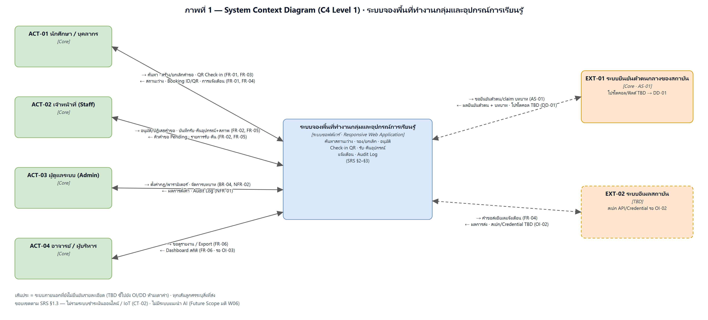
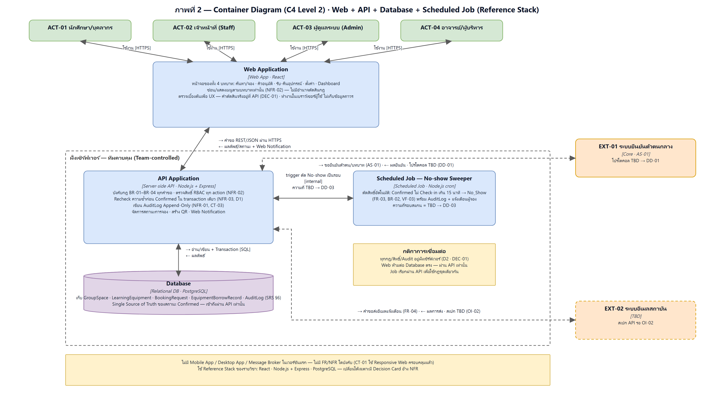

# 11 — Conceptual Architecture

> **Week 11 deliverable** — จัดทำตาม Lab "Context & Container (180 min)"
> เวอร์ชันเอกสารหลัก: [`11-conceptual-architecture-v0.1.docx`](11-conceptual-architecture-v0.1.docx) (ฟอร์ม 11 หัวข้อ)
> ไฟล์นี้เป็นสรุปฉบับ Markdown ประกอบ สถานะ: **Proposed (v0.1)** — รอตรวจในคาบ

## 1. Architecture Overview

ระบบแบ่งเป็น 4 container ตาม C4 ระดับ 2 โดยใช้ Reference Stack ของรายวิชา (React · Node.js + Express · PostgreSQL):

- **Web Application [Web App · React]** — หน้าจอของทั้ง 4 บทบาท ทำงานในเบราว์เซอร์ผู้ใช้ ซ่อน/แสดงเมนูตามบทบาทเท่านั้น (NFR-02) ไม่มีอำนาจตัดสินกฎ
- **API Application [Server-side API · Node.js + Express]** — จุดบังคับกฎเดียวของระบบ: กฎ BR-01–BR-04, สิทธิ์ RBAC ทุก action (NFR-02), recheck กันจองซ้ำ (NFR-03, D1), AuditLog Append-Only (NFR-01, CT-03)
- **Database [Relational DB · PostgreSQL]** — Single Source of Truth ของสถานะ Confirmed เก็บ entity ตาม SRS §6 เข้าถึงผ่าน API เท่านั้น
- **Scheduled Job — No-show Sweeper [Node.js cron]** — ตัดสิทธิ์อัตโนมัติเมื่อไม่ Check-in เกิน 15 นาที (FR-03, BR-02, VF-03) เรียกผ่าน API เพื่อใช้กฎชุดเดียวกัน

เหตุผลหลักที่เพิ่ม container ที่ 4: FR-03/BR-02 กำหนดให้ "ระบบยกเลิก**อัตโนมัติ**" และแผนตรวจสอบ VF-03 ของ SRS ระบุ "Background Worker" จึงต้องมีตัวประมวลผลเป็นรอบ — บันทึกเป็น DEC-03 (ส่วนความถี่รอบสแกนยังไม่กำหนดตัวเลข = TBD ชี้ไปยัง DD-03 ตามกติกา "Unknown = TBD")

## 2. Architecture View

### System Context (C4 ระดับ 1)

- 1 กล่องระบบ + Actor ครบ 4 บทบาทตาม SRS §2.2 + ระบบภายนอก 2 ระบบ (EXT-01 ยืนยันตัวตนกลาง [Core ตาม AS-01], EXT-02 อีเมลสถาบัน [TBD รอ OI-02])
- ทุกเส้นลูกศรระบุสิ่งที่ส่งทั้งสองทิศทาง ระบบที่ยังไม่ยืนยันรายละเอียดใช้เส้นประ

### Container Diagram (C4 ระดับ 2)

- Web ไม่ต่อ Database ตรง — ทุกคำขอผ่าน API (DEC-01); กฎ/สิทธิ์/Audit อยู่ฝั่งเซิร์ฟเวอร์ทั้งหมด (D2)
- ต้นฉบับแก้ไขได้: [`context-diagram.drawio`](../diagrams/architecture/context-diagram.drawio), [`container-diagram.drawio`](../diagrams/architecture/container-diagram.drawio)

## 3. Components / Modules

| Container | ชนิด · เทคโนโลยี | Responsibilities | รันที่ไหน / ใครควบคุม | Inputs/Outputs | Related Requirements |
|---|---|---|---|---|---|
| Web Application | Browser Web App · React | หน้าจอค้นหา/จอง, คิวอนุมัติ, รับ-คืนอุปกรณ์, ตั้งค่า, Dashboard; แสดง/ซ่อนเมนูตามบทบาท; ตรวจเบื้องต้นเพื่อ UX | เบราว์เซอร์ผู้ใช้ / ผู้ใช้ | ส่งคำขอ REST/JSON ผ่าน HTTPS; รับผลลัพธ์ + Web Notification | FR-01–FR-06, NFR-02, NFR-05, CT-01 |
| API Application | Server-side API · Node.js + Express | บังคับกฎ BR-01–BR-04; ตรวจสิทธิ์ทุก action; recheck ก่อน Confirmed; เขียน AuditLog; state machine; สร้าง QR; แจ้งเตือน | เซิร์ฟเวอร์ทีม / ทีม | SQL ไปยัง DB; เรียก EXT-01/EXT-02; รับ trigger จาก Job | FR-01–FR-05, BR-01–BR-04, NFR-01–NFR-03, CT-03 |
| Database | Relational DB · PostgreSQL | เก็บ GroupSpace, LearningEquipment, BookingRequest, EquipmentBorrowRecord, AuditLog (SRS §6); constraint กันจองซ้ำ | เซิร์ฟเวอร์ DB ทีม / ทีม (เข้าถึงผ่าน API เท่านั้น) | อ่าน/เขียนจาก API | FR-01, FR-05, NFR-01, NFR-03 |
| Scheduled Job — No-show Sweeper | Scheduled Job · Node.js cron | สแกน Confirmed ที่ไม่ Check-in เกิน 15 นาที → No_Show + AuditLog + แจ้งเตือน | เซิร์ฟเวอร์ทีม (cron) / ทีม | trigger ตัด No-show ผ่าน internal API | FR-03, BR-02, VF-03 |

## 4. Data and External Dependencies

| Dependency | Purpose | Risks / Constraints | Related Design Decision |
|---|---|---|---|
| EXT-01 ระบบยืนยันตัวตนกลางของสถาบัน | Login และ claim บทบาทของผู้ใช้ทุกคน (AS-01) | โปรโตคอล/ฟิลด์ยังไม่ยืนยัน — ระบบไม่เก็บรหัสผ่านเอง | DD-01, DEC-01 |
| EXT-02 ระบบอีเมลสถาบัน | ส่งแจ้งเตือนสถานะคำขอ (FR-04) | สเปก API/credential/Rate Limit รอ OI-02 — ชั่วคราวใช้ Web Notification in-app | DD-04 |
| PostgreSQL (Reference Stack) | ฐานข้อมูลเดียวของระบบ | ต้องรองรับ transaction/constraint กันจองซ้ำ (NFR-03) | DEC-02, DD-02 |

## 5. Architecture Rationale

- **กฎอยู่ที่เดียว (DEC-01):** ตรวจสิทธิ์/กฎ/Audit ใน API เท่านั้น เพราะผู้ใช้เรียก API ตรงได้ หน้าเว็บบังคับไม่ได้ — สอดคล้อง NFR-01/02/03 และ D2
- **ฐานข้อมูลเดียว (DEC-02):** สถานะ Confirmed ต้องมีแหล่งเดียวและบังคับด้วย transaction เพื่อกัน Double Booking ทุกกรณี (NFR-03, D1)
- **Job แยกต่างหาก (DEC-03):** งานตัดสิทธิ์ตามเวลาไม่ควรรอให้ใครมา trigger — แยกเป็น Scheduled Job ที่เรียกผ่าน API เพื่อใช้กฎชุดเดียวกัน
- **ข้อจำกัด:** ยังไม่มี Mobile/Desktop App (ไม่มี FR/NFR บังคับ — CT-01 ใช้ Responsive Web); กลไกกันซ้ำระดับ DB (DD-02), ความถี่ Job (DD-03), Email API (OI-02) และบทลงโทษ No-show สะสม (OI-01) ยังเปิดอยู่ — ห้ามเดาค่า
- **ประเด็นค้าง:** รอ Policy ลายลักษณ์อักษร (AS-02/OI-01) ก่อนล็อกพฤติกรรม No-show ขั้นสุดท้าย

## 6. Quality Attribute Evaluation Questions

- การออกแบบนี้ป้องกันการจองซ้ำ (Double Booking) ได้อย่างไรเมื่อผู้ใช้กดยืนยันพร้อมกัน? → recheck ที่ API + transaction เดียวที่ DB (DEC-02, DD-02 — กลไกละเอียดตัดสินใน W13)
- ถ้าผู้ใช้เรียก API ตรงโดยไม่ผ่านหน้าเว็บ ระบบยังปลอดภัยหรือไม่? → ใช่ เพราะสิทธิ์/กฎตรวจที่ API ทุก action (DEC-01, NFR-02)
- Audit Log ถูกแก้ไข/ลบได้หรือไม่? → ไม่ได้ ออกแบบเป็น Append-Only (NFR-01, CT-03 — กลไก DB ใน W13)
- ผู้ใช้บนมือถือเข้าถึงได้อย่างไร? → Responsive Web ตั้งแต่ 375px (NFR-05, CT-01) ออกแบบหน้าจอใน W12
- ใครตัดสิทธิ์ No-show และเมื่อไร? → Scheduled Job สแกนเป็นรอบ (ความถี่ = DD-03) เรียกผ่าน API; เกณฑ์ 15 นาทีจาก BR-02 (บทลงโทษสะสมรอ OI-01)
- ระบบรับรู้สถานะ "ว่าง" ได้เร็วพอหรือไม่ (NFR-04)? → โครงสร้าง 3 ชั้นไม่มีชั้นเพิ่มใน v1; แผนวัด p95 ≤ 3 วินาที ทำใน W13/W14
